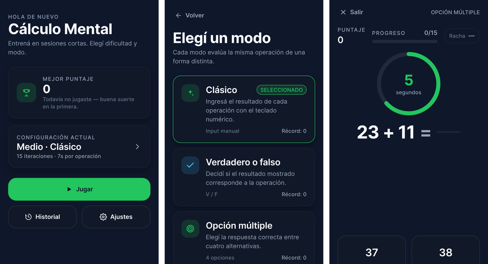

# Cálculo Mental

> **English summary.** Mental-math training mobile app (course project, *Desarrollo de Apps*, UADE): short rounds, four game modes (classic, true/false, multiple choice, time attack), three difficulty levels, scoring with a speed bonus, local progress and stats, and optional haptics and sound. Built with React Native + Expo SDK 54, TypeScript, Zustand, AsyncStorage, react-native-svg and Reanimated. Works fully offline.

<p align="center"></p>

App móvil para entrenar cálculo mental. La idea: rondas cortas de operaciones, varios modos de juego, dificultad configurable y persistencia local del progreso. Hecha con React Native + Expo Go, TypeScript, sin backend y sin red.

Es la entrega de la actividad **Desafío Cálculo Mental** de la materia Desarrollo de Apps. Está pensada para correr en celular con Expo Go (no usa módulos nativos que requieran un dev client).

## Qué hay adentro

- 4 modos de juego: clásico (input numérico), verdadero/falso, opción múltiple y contra reloj.
- 3 niveles de dificultad con rangos de números, operadores y tiempo distintos.
- Sistema de puntaje con bonus por velocidad y penalización por error o timeout.
- Persistencia local de configuración, historial de partidas, mejores puntajes y estadísticas acumuladas.
- Gráficos custom (donut + barras) hechos con `react-native-svg`.
- Feedback háptico y sonoro opcional (con toggle en configuración).
- Dificultad dinámica opcional: el tiempo por operación se va achicando dentro de una misma ronda.

## Cómo correr

Requiere Node 18+ y la app **Expo Go** en el celular.

```bash
npm install
npx expo start
```

Después escaneás el QR con Expo Go (iOS) o desde la app Expo Go (Android). Si en tu red empresarial el túnel anda mejor:

```bash
npx expo start --tunnel
```

Para verificar tipos sin levantar la app:

```bash
npm run typecheck
```

> La app funciona 100% offline después del primer arranque — escaneá el QR en LAN o usá `--tunnel` y, si querés, activá modo avión.

## Stack

- **React Native 0.81** + **Expo SDK 54** (Expo Go compatible).
- **TypeScript** estricto.
- **React Navigation** (`native-stack`) para navegar entre pantallas.
- **Zustand** + middleware `persist` para el estado global (settings + stats). Más liviano que Context+Reducer y enchufa directo con AsyncStorage.
- **AsyncStorage** como capa de persistencia.
- **react-native-svg** para los gráficos y los íconos (los hago a mano en `IconGlyph` para no depender de `@expo/vector-icons`).
- **react-native-reanimated** para animaciones (overlays de feedback, transiciones, toggles, barra de progreso).
- **expo-haptics** + **expo-av** para vibración y sonidos opcionales.
- **@expo-google-fonts/inter** para tipografía Inter.

## Estructura

```
actividad-juego-numeros/
├── App.tsx                  # Bootstrap: fuentes, splash, providers, navegación
├── app.json                 # Config Expo
├── package.json
├── tsconfig.json
├── babel.config.js
├── assets/
│   └── sounds/              # opcional: mp3 cortos para correct/wrong/timeout/finish
└── src/
    ├── navigation/          # stack + tipos de navegación
    ├── screens/             # 7 pantallas: Splash, Home, Config, ModeSelect, Game, Results, History
    ├── components/
    │   ├── ui/              # primitivos (Screen, Card, Button, Text, ProgressBar, ...)
    │   ├── game/            # piezas del gameplay (TimerRing, OperationDisplay, Keypad, ...)
    │   └── charts/          # DonutChart y BarChart
    ├── hooks/               # useGameEngine, useCountdown, useHaptics, useSounds
    ├── services/            # operationGenerator, scoring, distractors, dynamicDifficulty
    ├── store/               # Zustand: settingsStore, statsStore
    ├── storage/             # claves de AsyncStorage
    ├── constants/           # tema, dificultad, modos
    ├── types/               # tipos de dominio (game, stats)
    └── utils/               # math, format, id
```

La lógica matemática (generador de operaciones, scoring, dificultad dinámica) está totalmente desacoplada de la UI: vive en `services/` y se consume desde el hook `useGameEngine`. Eso hace fácil cambiar reglas sin tocar componentes.

## Manejo del estado

Hay dos stores Zustand persistidos:

- **`settingsStore`**: dificultad, iteraciones, modo elegido, toggles de sonido / vibración / dificultad dinámica.
- **`statsStore`**: historial (cap de 50 partidas, FIFO), `bestByMode` (récord por modo) y `totals` acumulados (precisión promedio, tiempo promedio, puntaje total).

El estado de la **partida en curso** lo lleva el hook `useGameEngine`, que combina `useState` para lo que la UI renderiza con un `ref` interno (`stateRef`) que mantiene el snapshot autoritativo para que los `setTimeout`/`setInterval` no sufran closures stale. Las funciones críticas (`advance`, `handleOutcome`, `finalize`) viven en refs y siempre apuntan a la versión más reciente.

Cuando una partida termina, `finalize` arma un `GameSession` y se lo pasa a `statsStore.addSession(...)`, que recalcula `bestByMode` y `totals` para que sigan consistentes.

## Lógica de operaciones por dificultad

Definida en `constants/difficulty.ts` y consumida por `services/operationGenerator.ts`.

| Nivel    | Operadores       | Rango A | Rango B | Tiempo/op | Iter por defecto |
|----------|------------------|---------|---------|-----------|------------------|
| Fácil    | + −              | 1–20    | 1–20    | 10 s      | 10               |
| Medio    | + − × ÷          | 2–30    | 2–12    | 7 s       | 15               |
| Difícil  | + − × ÷ y combinadas | 5–99 | 2–15    | 5 s       | 20               |

Detalles:

- **Restas**: si `b > a` se swapea para no entregar negativos en fácil/medio.
- **Divisiones**: se generan desde el resultado (`a = b * result`), así siempre dan entero.
- **Combinadas (difícil)**: 30% de chance de generar `a op1 b op2 c` con prioridad de operadores resuelta en código (no se delega al `eval`).
- **Verdadero/falso**: 50% de chance de mostrar el resultado correcto, el resto un offset chico (±1..±N) para que sea creíble.
- **Opción múltiple**: distractores cerca del resultado correcto (`±20%` del valor con piso de ±2), todos únicos, shuffleados.

## Sistema de puntaje

En `services/scoring.ts`:

| Caso                                  | Puntos |
|---------------------------------------|-------:|
| Correcta rápida (< 75% del tiempo)    |  +100  |
| Correcta normal                       |   +70  |
| Incorrecta                            |   −30  |
| Sin responder (timeout)               |   −50  |

El puntaje final de una partida se reporta clampeado a 0 (no mostramos negativos al final, aunque internamente la suma puede ir abajo de cero durante la ronda).

## Persistencia

Dos claves en AsyncStorage:

- `calc-mental:settings:v1`
- `calc-mental:stats:v1`

Las dos están versionadas para poder migrar a `:v2` si más adelante cambia el esquema (ej: agregamos perfiles).

El historial se trunca a 50 partidas (FIFO). En cada `addSession` recalculamos `bestByMode` y `totals` desde cero a partir de la lista, así nunca se desincronizan.

## Decisiones de diseño

- **Paleta oscura** (#0F172A bg, #111827 cards, accent #22C55E, secundario #38BDF8). Pensada para uso en interiores y para que los flashes de feedback (verde/rojo) sean evidentes sin lastimar la vista.
- **Tipografía Inter** cargada con `@expo-google-fonts/inter`. Tres pesos (regular, medium, semibold, bold) y una jerarquía clara: `display` para puntajes, `title` para encabezados, `body/caption` para el resto.
- **Componentes propios** en lugar de una librería de UI: `Card`, `Button`, `Chip`, `Toggle`, `StatTile`. Da más control y queda más prolijo que mezclar `@react-native-paper` o `react-native-elements` con estilos custom.
- **Íconos en SVG hechos a mano** (`IconGlyph`) para no agregar `@expo/vector-icons` (que pesa varios megas y trae un set enorme que no uso).
- **Gráficos en SVG** (donut + barras) en vez de `victory-native`. Pasan a ser piezas chiquitas y consistentes con el resto del look.
- **Animaciones con Reanimated** en lugar de `Animated` clásico — corren en el hilo de UI y se ven más fluidas. Las uso para: progress bar, fade del feedback, transición entre operaciones, toggle.
- **Diseño mobile-first**: padding consistente (`spacing.xl` en bordes), botones de min 56px, tap targets grandes.

## Sonidos

El hook `useSounds` ya está cableado, pero `assets/sounds/` viene vacío. Para activar audio:

1. Dejá `correct.mp3`, `wrong.mp3`, `timeout.mp3` y `finish.mp3` en `assets/sounds/`.
2. En `src/hooks/useSounds.ts`, en el objeto `SOURCES`, reemplazá los `null` por `require('../../assets/sounds/correct.mp3')` y demás.

Sin esos archivos la app igual funciona — el hook es no-op silencioso. Lo dejé así para no inflar el bundle con audio genérico.

## Dificultades que aparecieron

- **Closures stale en el motor del juego.** La primera versión de `useGameEngine` declaraba `advance` y `handleOutcome` con `useCallback` y los disparaba desde `setTimeout`. El timer capturaba la versión de la función al momento de programarse, así que después de la primera operación quedaban viendo `answers=[]` y `score=0`. Lo resolví guardando las funciones críticas en `ref`s que se reasignan en cada render y manteniendo un `stateRef` con el snapshot autoritativo. Los `setTimeout` ahora llaman `handleOutcomeRef.current(...)` y siempre ven el estado actualizado.
- **División que diera entero.** Ir generando `a` y `b` aleatorios y filtrar los casos no enteros descartaba un montón de combinaciones. Lo invertí: genero `b` y `result` primero, y armo `a = b * result`. Listo, una división por intento.
- **Distractores creíbles en opción múltiple.** Si los hacés muy lejanos, se nota cuál es la correcta a simple vista. Los limito a ±20% del valor (con piso de ±2) y me aseguro de que sean únicos y distintos del correcto.
- **Operaciones combinadas con precedencia.** En difícil hay 30% de chance de `a op1 b op2 c`. Resuelvo la precedencia explícitamente (`evalCombined`) para no usar `eval` y para mantener el resultado consistente con cómo se muestra.
- **Recalcular totales sin perder consistencia.** En vez de actualizar totales incrementalmente al insertar una sesión (y riesgo de drift), los recalculo desde la lista entera. Con cap de 50 sesiones el costo es despreciable y elimina una clase entera de bugs.

## Cómo probar cada modo

1. Abrí Expo Go con el QR. Ves la splash → llega a Home.
2. Tocá **Ajustes** o el card de configuración: elegí dificultad, iteraciones, y activá / desactivá toggles.
3. Volvé y tocá **Jugar** → elegí un modo.
4. Para **clásico**: aparece teclado numérico. Escribí el resultado y confirmá.
5. Para **verdadero/falso**: aparece la operación con un resultado propuesto, tocá Verdadero o Falso.
6. Para **opción múltiple**: 4 opciones — tocá la correcta.
7. Para **contra reloj**: como clásico, pero hay 60 segundos globales y no hay límite de operaciones.
8. Al terminar (o cuando se agote el tiempo global), vas a Resultados con puntaje, donut chart y stats.
9. En **Historial** ves las últimas partidas, mejores por modo y un gráfico de barras con la precisión de las últimas 10.

Para validar persistencia: cerrá Expo Go, reabrí — ajustes e historial siguen ahí.
